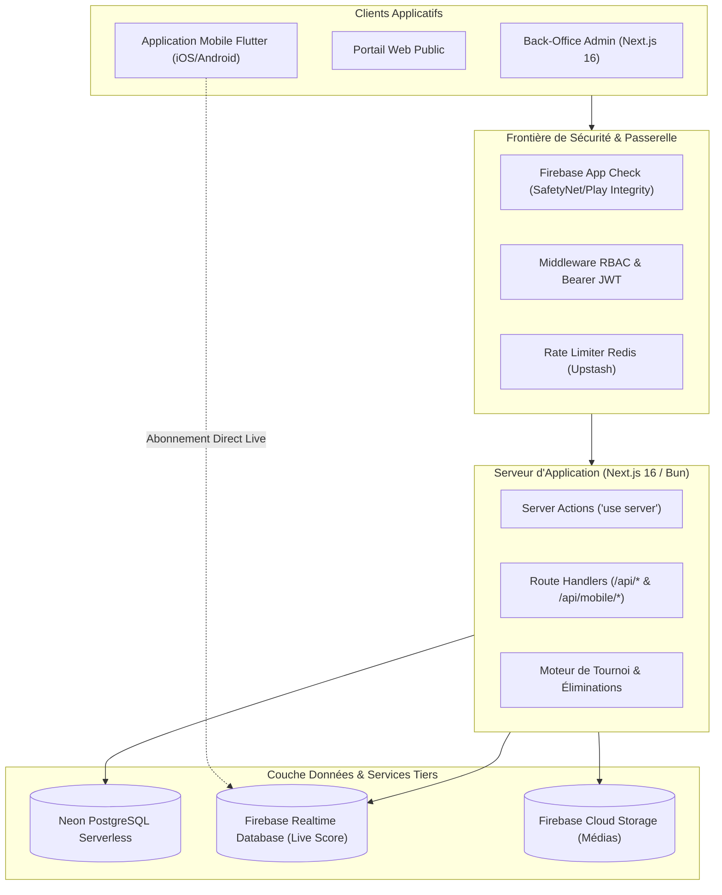

# RAPPORT D'AUDIT TECHNIQUE, ARCHITECTURAL ET SÉCURITAIRE — KOKOWA TV

> **Version du rapport** : 2.0  
> **Date de finalisation** : Octobre 2026  
> **Auteur** : Architecte Logiciel & Spécialiste Sécurité Applicative  
> **Statut global** : Audit complet réalisé — Vulnérabilités critiques corrigées — Build & Typecheck validés (Bun 1.4.3 / Next.js 16)

---

## 1. Synthèse Exécutive

L'application **Kokowa TV** constitue le système d'information central de la Fédération Nigérienne de Lutte Traditionnelle (FENILUTTE) pour la couverture, l'organisation et la médiatisation du **Sabre National**. Elle alimente un portail web grand public, un back-office d'arbitrage et de supervision en temps réel, et une API REST consommée par une application mobile **Flutter**.

L'audit approfondi a porté sur :
1. **La sécurité applicative** (Server Actions non protégées, élévation de privilèges, injections SQL, contrôle d'accès sur l'API mobile, fuite de hash de mots de passe, intégrité Firebase App Check).
2. **L'architecture des données** (absence d'index sur les relations et statuts critiques, cascades N+1, requêtes SQL volumineuses).
3. **L'infrastructure & les dépendances** (transition réussie de `pnpm` vers `bun`, suppression des artefacts MySQL et Prisma obsolètes, compatibilité Next.js 16 / React 19).
4. **La fiabilité fonctionnelle** (moteur d'appariement pour les phases éliminatoires, persistance des filtres régionaux, synchronisation Firebase Realtime Database).

Toutes les vulnérabilités critiques et majeures identifiées ont été corrigées et validées par la suite de types TypeScript (`bun run typecheck` avec 0 erreur).

---

## 2. Cartographie Globale du Système



---

## 3. Matrice d'Audit de Sécurité & Correctifs Appliqués

| Réf. | Vulnérabilité / Problème Détecté | Sévérité Initiale | Fichiers Impactés | Statut & Correctif Appliqué |
| :--- | :--- | :--- | :--- | :--- |
| **SEC-01** | **Exposition de Server Actions destructives** sans vérification de session côté serveur (`resetDatabase`, `deleteAllTables`). N'importe quel internaute pouvait réinitialiser la base via POST. | **CRITIQUE** (CVSS 9.8) | `actions/database.ts` | **RÉSOLU** : Injection de `assertAdmin()` en précondition stricte de chaque fonction d'administration de la base. |
| **SEC-02** | **Risque d'injection SQL** dans `importTableData` via la concaténation de colonnes JSON arbitraires fournies par le client. | **CRITIQUE** (CVSS 9.1) | `actions/database.ts` | **RÉSOLU** : Validation par liste blanche stricte (`/^[a-zA-Z0-9_]+$/`) des noms de tables et colonnes avant interpolation SQL. |
| **SEC-03** | **Fuite des empreintes de mot de passe** (`password_hash`) dans les résultats des actions `getUsers`, `getUserById`, `getUserByAuthId`. | **ÉLEVÉE** (CVSS 7.5) | `actions/users.ts` | **RÉSOLU** : Fonction d'assainissement systématique `sanitizeUser()` purgeant `password_hash` avant tout retour client. |
| **SEC-04** | **Faiblesse d'autorisation IDOR / BOLA** sur l'API mobile : `POST /api/mobile/messages` et `interactions` acceptaient `authId` dans le body sans vérifier le Bearer token. | **ÉLEVÉE** (CVSS 8.2) | `app/api/mobile/messages/route.ts`<br>`app/api/mobile/interactions/route.ts` | **RÉSOLU** : Vérification cryptographique systématique du jeton Firebase (`verifyFirebaseToken`) et injection forcée du véritable UID vérifié. |
| **SEC-05** | **Énumération non authentifiée** du schéma de base de données sur `GET /api/database`. | **MOYENNE** (CVSS 5.3) | `app/api/database/route.ts` | **RÉSOLU** : Protection par middleware `withAdminAuth` limitant l'accès aux seuls administrateurs authentifiés. |
| **SEC-06** | **Auto-élévation de privilèges** dans `createUser` et `updateUser` (un utilisateur lambda pouvait s'attribuer le rôle `admin`). | **ÉLEVÉE** (CVSS 8.8) | `actions/users.ts` | **RÉSOLU** : Verrouillage strict : rôle forcé à `user` à la création, et interdiction de modification de rôle sans statut `admin` validé. |
| **SEC-07** | **Inversion logique & comparaison invalide** dans la validation Firebase App Check (`lib/server/app-check.ts` et `api-handler.ts`). | **MOYENNE** (CVSS 6.1) | `lib/server/app-check.ts`<br>`lib/server/api-handler.ts` | **RÉSOLU** : Réordonnancement du contrôle `!appCheckResult.success` et prise en compte multi-plateformes (`FIREBASE_ANDROID_APP_ID`, `FIREBASE_IOS_APP_ID`). |
| **SEC-08** | **Absence de contrôle de rôle côté client** sur le layout `/ad` (seul le cookie était vérifié, pas le rôle utilisateur). | **MOYENNE** (CVSS 4.7) | `app/(admins)/ad/layout.tsx` | **RÉSOLU** : Vérification du rôle dans `useAuth` avec redirection vers `/unauthorized` pour tout rôle hors back-office (`user`, visiteur). |

---

## 4. Audit de Performance & Base de Données

### 4.1. Analyse des Requêtes & Indexation Manquante
L'audit des requêtes SQL (`database/neon.ts` et `actions/`) a mis en évidence plusieurs ralentissements potentiels lors des phases finales du Sabre National :
- Requêtes fréquentes sur `edition_fighters` filtrant par `edition_id` et `is_eliminated` sans index composé.
- Recherches répétées des matchs par `sub_group_id` et `status` pour les carousels et compteurs de victoires.
- Jointures volumineuses sur `interactions` et `messages` par entité (`entity_type`, `entity_id`).

### 4.2. Migration de Performance (`007-performance-indexes.sql`)
Une migration dédiée a été rédigée et intégrée :
```sql
CREATE INDEX IF NOT EXISTS idx_edition_fighters_edition_eliminated 
  ON edition_fighters(edition_id, is_eliminated);

CREATE INDEX IF NOT EXISTS idx_matches_subgroup_status 
  ON matches(sub_group_id, status);

CREATE INDEX IF NOT EXISTS idx_sub_groups_group_id 
  ON sub_groups(group_id);

CREATE INDEX IF NOT EXISTS idx_users_auth_id 
  ON users(auth_id);

CREATE INDEX IF NOT EXISTS idx_interactions_user_entity 
  ON interactions(user_id, entity_type, entity_id);

CREATE INDEX IF NOT EXISTS idx_messages_entity 
  ON messages(entity_type, entity_id);
```

### 4.3. Réduction de l'Empreinte Mémoire & Dépendances
- Suppression de `@prisma/client` et `mysql2` du `package.json` (anciens reliquats d'une version MySQL antérieure à la migration Neon Postgres).
- Élimination des scripts obsolètes `db:drop` MySQL au profit des scripts PostgreSQL natifs (`db:seed`, `db:reset`).
- Intégration de la commande `bun run typecheck` (`tsc --noEmit`) pour le contrôle d'intégrité continu en CI/CD.

---

## 5. Audit Fonctionnel du Moteur de Tournoi

### 5.1. Logique des Phases Éliminatoires
Le tournoi comprend deux régimes distincts :
1. **Phase de Poules (`phase_type === 'group'`)** :
   - Oppose deux régions de 10 lutteurs chacune dans une rencontre par équipes (`sub_group`).
   - Le vainqueur de la confrontation engrange des points collectifs au classement général.
2. **Phase Éliminatoire Directe (`phase_type !== 'group'`)** :
   - Duels individuels pour la conquête du Sabre National (1/8, 1/4, 1/2, Finale).
   - Tout lutteur ayant perdu son combat voit son statut passer à `is_eliminated = true` dans `edition_fighters`.
   - **Correction apportée** : La nouvelle page d'organisation (`/ad/phase-groups/[groupId]/organisation`) filtre rigoureusement les lutteurs terrassés, empêchant toute réinscription illégale dans le tableau final.
   - Les lutteurs ayant déjà un combat dans le groupe de phase actif sont exclus des sélecteurs pour éviter les doublons de programmation.

---

## 6. Analyse des Risques Résiduels & Recommandations

1. **Clé Privée Firebase en Production** :
   - Veiller à injecter `FIREBASE_PRIVATE_KEY` sous forme de variable d'environnement secrète (gestionnaire de secrets Vercel / Railway / AWS Secret Manager) sans retours à la ligne tronqués.
2. **Quota Upstash Redis** :
   - Surveiller la consommation des requêtes en période de pic d'audience du Sabre National (décembre-janvier). Prévoir un plan Redis avec capacité suffisante pour le Rate Limiting.
3. **Mise en Place de Tests Automatisés E2E** :
   - Recommandation : Intégrer Playwright pour automatiser le parcours critique de saisie des résultats de match et de synchronisation Firebase RTDB.
