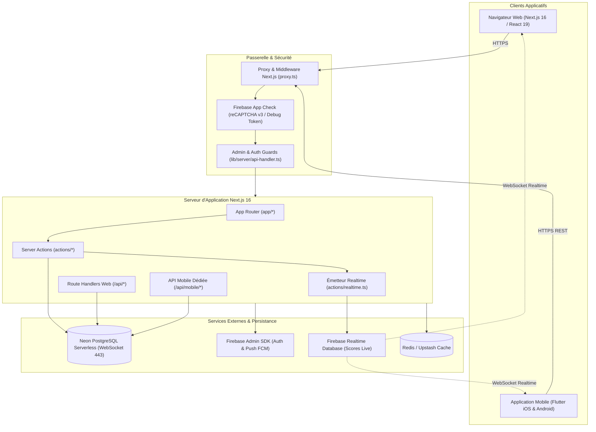
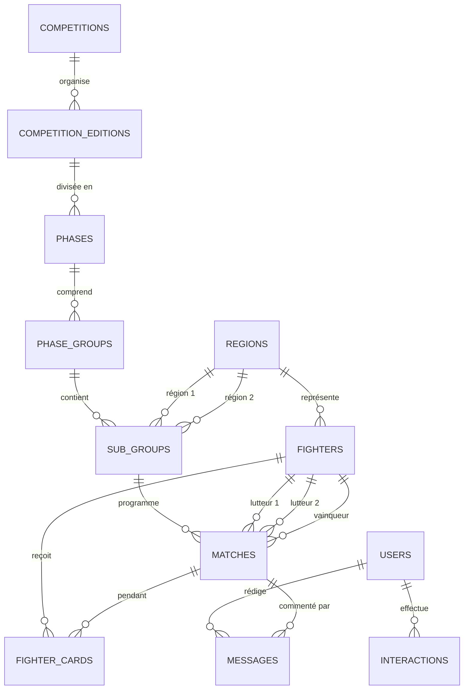

# Architecture Technique et Fonctionnelle — Kokowa TV

## 1. Introduction & Vue d'Ensemble

**Kokowa TV** est la plateforme numérique de référence dédiée à la promotion, la diffusion en direct, la gestion sportive et l'archivage de la lutte traditionnelle nigérienne (*Kokowa*).

Le système est conçu selon une architecture moderne hybride, combinant :
- Une application web interactive haute performance construite avec **Next.js 16 (App Router)** et **React 19**.
- Une suite complète d'**APIs REST dédiées pour l'application mobile Flutter** (`/api/mobile/*`).
- Une synchronisation en direct par **Firebase Realtime Database (RTDB)** et **Cloud Firestore** pour la diffusion des scores, des rounds et des événements de combat.
- Une base de données relationnelle serverless **Neon PostgreSQL** accédée de manière résiliente via WebSocket sécurisé (port 443).
- Une couche de sécurité multi-niveaux articulée autour de **Firebase Authentication**, **Firebase App Check (reCAPTCHA v3)**, et des **guards d'administration côté serveur**.

---

## 2. Schéma Architectural Global



---

## 3. Cartographie Complète des Dossiers et Fichiers

```
kokowa_tv/
├── actions/                         # Logique métier serveur (Next.js Server Actions)
│   ├── mobile/                      # Actions optimisées pour les flux mobiles Flutter
│   │   ├── advertisements.ts        # Publicités et bannières pour l'application mobile
│   │   ├── app-settings.ts          # Paramètres de configuration mobile
│   │   ├── articles.ts              # Flux d'actualités pour mobile
│   │   ├── competitions.ts          # Liste et détails des compétitions
│   │   ├── editions.ts              # Éditions et palmarès
│   │   ├── fighters.ts              # Fiches lutteurs, statistiques et classement
│   │   ├── getEditionRegions.ts     # Répartition régionale par édition
│   │   ├── interactions.ts          # Likes, favoris, partages depuis le mobile
│   │   ├── matches.ts               # Matches du jour, programmés et résultats
│   │   ├── messages.ts              # Commentaires et messages communautaires
│   │   ├── referees.ts              # Corps arbitral
│   │   ├── regions.ts               # Régions administratives et écuries
│   │   ├── teams.ts                 # Équipes et délégations régionales
│   │   └── transfers.ts             # Historique des transferts entre régions
│   ├── advertisements.ts            # Gestion des campagnes publicitaires web
│   ├── app-settings.ts              # Paramètres globaux de l'application (durée match, etc.)
│   ├── archives.ts                  # Archives historiques et palmarès national
│   ├── articles.ts                  # Gestion des publications et articles de presse
│   ├── belts.ts                     # Gestion des ceintures (rouge, blanche, etc.)
│   ├── cache-utils.ts               # Utilitaires d'invalidation et revalidation de cache
│   ├── coaches.ts                   # Encadrement technique et entraîneurs
│   ├── competitions.ts              # Compétitions nationales (Sabre National, etc.)
│   ├── cookies.ts                   # Gestion sécurisée des cookies serveur
│   ├── database.ts                  # Actions d'administration et santé base de données
│   ├── editions.ts                  # Éditions annuelles des compétitions
│   ├── entities.ts                  # Gestionnaire générique d'entités avec pagination
│   ├── fighter-cards.ts             # Cartons disciplinaires (jaunes, rouges)
│   ├── fighter-transfers.ts         # Enregistrement des mutations de lutteurs
│   ├── fighters.ts                  # Profils complets, mensurations et palmarès
│   ├── interactions.ts              # Système d'interactions (like, bookmark, follow)
│   ├── matches.ts                   # Gestion du cycle de vie des combats (création, live, fin)
│   ├── media.ts                     # Galerie multimédia, vidéos et photos
│   ├── messages.ts                  # Messagerie directe et commentaires d'entités
│   ├── notifications.ts             # Notifications push et in-app
│   ├── phase-groups.ts              # Groupes de phase (poules A/B ou poules éliminatoires)
│   ├── phases.ts                    # Phases de compétition (éliminatoires, quarts, demi, finale)
│   ├── realtime.ts                  # Synchronisation bidirectionnelle Firebase RTDB
│   ├── referees.ts                  # Arbitres centraux et juges de table
│   ├── regions.ts                   # 8 régions du Niger et écuries associées
│   ├── stats.ts                     # Agrégations statistiques globales et par région
│   ├── sub-groups.ts                # Sous-groupes / Rencontres entre deux régions
│   ├── teams.ts                     # Composition des équipes régionales
│   ├── users.ts                     # Gestion des comptes utilisateurs et rôles
│   └── videos.ts                    # Flux vidéo, streaming direct et replays
│
├── app/                             # Next.js 16 App Router (Pages, Layouts, API Routes)
│   ├── (admins)/                    # Groupe de routes sécurisées réservé à l'administration
│   │   └── ad/                      # Dashboard d'administration central
│   │       ├── achievements/        # Gestion des trophées et distinctions
│   │       ├── advertisements/      # Régie publicitaire
│   │       ├── articles/            # Rédaction et publication d'articles
│   │       ├── coaches/             # Registre des entraîneurs
│   │       ├── competitions/        # Création et configuration des compétitions
│   │       ├── database/            # Console d'état Neon PostgreSQL
│   │       ├── editions/            # Gestion des éditions annuelles
│   │       ├── fighters/            # Gestion des fiches lutteurs
│   │       ├── matches/             # Pilotage des combats en direct
│   │       ├── media/               # Médiathèque
│   │       ├── messages/            # Modération des échanges
│   │       ├── notifications/       # Diffusion de notifications broadcast
│   │       ├── phase-groups/        # Tirages au sort et groupes
│   │       ├── phases/              # Définition des phases de tournoi
│   │       ├── referees/            # Désignation des arbitres
│   │       ├── regions/             # Configuration des régions
│   │       ├── stats/               # Tableaux de bord analytiques
│   │       ├── sub-groups/          # Programmation des rencontres
│   │       ├── system/              # Configuration avancée du système
│   │       ├── teams/               # Gestion des délégations
│   │       ├── transfers/           # Validation des mutations sportives
│   │       ├── users/               # Rôles et habilitations
│   │       ├── videos/              # Liens de streaming et vidéos
│   │       ├── layout.tsx           # Layout d'administration avec vérification de rôle
│   │       └── page.tsx             # Vue d'accueil du tableau de bord
│   ├── (user)/                      # Groupe de routes utilisateur connecté
│   │   └── profile/                 # Profil, historique et préférences de l'utilisateur
│   ├── api/                         # Endpoints REST de l'application
│   │   ├── mobile/                  # API v1 consommée par l'application Flutter
│   │   │   ├── articles/            # Actualités pour mobile
│   │   │   ├── competitions/        # Compétitions pour mobile
│   │   │   ├── editions/            # Éditions pour mobile
│   │   │   ├── fighters/            # Lutteurs pour mobile
│   │   │   ├── interactions/        # Interactions utilisateur mobile
│   │   │   ├── matches/             # Matches et directs pour mobile
│   │   │   ├── messages/            # Commentaires pour mobile
│   │   │   ├── pubs/                # Publicités natives mobile
│   │   │   ├── referees/            # Arbitres pour mobile
│   │   │   ├── regions/             # Régions pour mobile
│   │   │   ├── settings/            # Paramètres et règles du jeu pour mobile
│   │   │   ├── teams/               # Équipes régionales pour mobile
│   │   │   └── transfers/           # Mutations pour mobile
│   │   ├── auth/                    # Synchronisation et session Firebase Auth
│   │   │   ├── me/                  # Profil de l'utilisateur courant connecté
│   │   │   ├── sign-in/             # Vérification de connexion
│   │   │   ├── sign-out/            # Déconnexion et purge de session
│   │   │   └── sync/                # Synchronisation Firebase UID <-> PostgreSQL
│   │   ├── app-settings/            # API des paramètres système
│   │   ├── matches/                 # API publique et admin des matches
│   │   ├── fighters/                # API publique des lutteurs
│   │   ├── competitions/            # API publique des compétitions
│   │   ├── stats/                   # API des statistiques publiques
│   │   └── database/                # API de contrôle technique de la base
│   ├── articles/                    # Consultation publique des actualités
│   ├── auth/                        # Pages d'authentification publique
│   │   ├── forget-password/         # Récupération de mot de passe
│   │   ├── reset-password/          # Réinitialisation
│   │   ├── sign-in/                 # Connexion
│   │   └── sign-up/                 # Inscription
│   ├── competitions/                # Vue publique des compétitions
│   ├── fighters/                    # Annuaire public des lutteurs avec filtres
│   ├── matches/                     # Liste des matches avec filtrage avancé et onglets
│   │   ├── [matchId]/               # Page détaillée d'un match (chronomètre, live, onglets)
│   │   └── page.tsx                 # Grille / Liste publique avec recherche multicritères
│   ├── presentation/                # Module institutionnel et stratégique complet (17 chapitres)
│   ├── layout.tsx                   # Layout racine (ThemeProvider, AppCheckProvider, QueryProvider)
│   └── page.tsx                     # Page d'accueil publique de Kokowa TV
│
├── components/                      # Composants React réutilisables
│   ├── dashboard/                   # Composants du tableau de bord admin (Sidebar, Nav, Items)
│   ├── entities/                    # Cartes génériques d'affichage d'entités sportives
│   ├── layout/                      # Header, Footer, Navbar et navigation principale
│   ├── pages/                       # Composants spécifiques par domaine fonctionnel
│   │   ├── fighters/                # FighterCard moderne avec animations et stats
│   │   └── matches/                 # MatchDetailHeader, MatchesGrid, MatchComments, etc.
│   ├── presentation/                # Composants du module de présentation (17 chapitres)
│   ├── providers/                   # Providers transversaux (AppCheckProvider)
│   ├── shared/                      # Boutons d'interaction, bannières, modals
│   └── ui/                          # Bibliothèque UI (Shadcn UI / Radix UI)
│
├── configs/                         # Configurations client
│   ├── firebase/
│   │   └── config.ts                # Initialisation sécurisée Firebase App (SSR-safe)
│   └── locales/                     # Fichiers de localisation et libellés
│
├── constants/                       # Constantes applicatives et menus
│   └── admin-items.ts               # Structure du menu de la barre latérale admin
│
├── contexts/                        # React Contexts
│   ├── app-settings-context.tsx     # Contexte des paramètres de configuration
│   └── auth-context.tsx             # Contexte d'authentification (Firebase + User PostgreSQL)
│
├── database/                        # Schémas et scripts de base de données
│   ├── migrations/                  # Fichiers de migrations SQL incrémentales
│   └── schema.sql                   # Schéma relationnel initial
│
├── hooks/                           # Custom React Hooks
│   ├── realtime/                    # Hooks d'écoute temps réel RTDB (useRealtimeMatch)
│   ├── use-active-route.ts          # Détection de l'onglet actif dans la navigation
│   ├── use-auth.ts                  # Gestion du cycle de vie de l'utilisateur authentifié
│   ├── use-interactions.ts          # Actions de Like, Bookmark, Follow, Share
│   ├── use-match-filters.ts         # État des filtres combinés pour les matches
│   ├── use-matches.ts               # Requêtes et pagination TanStack Query pour les matches
│   └── use-message.ts               # Messagerie et commentaires en direct
│
├── lib/                             # Bibliothèques, connecteurs et services internes
│   ├── client/                      # Outils client
│   │   ├── api.ts                   # Client HTTP Axios avec injection des tokens
│   │   └── firebase-app-check.ts    # Initialisation résiliente de Firebase App Check
│   ├── db/                          # Gestionnaire de base de données Neon PostgreSQL
│   │   ├── connection.ts            # Réexportation et compatibilité ascendante
│   │   └── neon-client.ts           # Pool WebSocket Neon (port 443), retries et transactions
│   ├── server/                      # Utilitaires serveur
│   │   ├── api-handler.ts           # Wrapper standard d'API REST (CORS, validation, Auth, App Check)
│   │   ├── app-check.ts             # Validation des jetons App Check via Firebase Admin
│   │   ├── auth-middleware.ts       # Détection et parsing de jetons JWT / Bearer
│   │   └── auth-utils.ts            # Résolution de l'utilisateur PostgreSQL depuis le Firebase UID
│   ├── services/                    # Logique métier avancée
│   │   └── match-update.service.ts  # Recalcul des scores, éliminations et synchronisation RTDB
│   ├── firebase-admin.ts            # Initialisation singleton du SDK Firebase Admin
│   ├── push.ts                      # Envoi des notifications push Firebase Cloud Messaging
│   └── utils.ts                     # Utilitaires de formatage et classes CSS (cn)
│
├── providers/                       # Fournisseurs d'état d'infrastructure
│   ├── query-provider.tsx           # TanStack Query Client Provider
│   └── theme-provider.tsx           # NextThemesProvider avec suppression de faux positif React 19
│
├── proxy.ts                         # Middleware Edge Next.js (sécurisation, headers, redirections)
├── tests/                           # Tests automatisés avec Bun Test
│   ├── auth-middleware.test.ts      # Tests unitaires de détection de session et jeton
│   └── middleware.test.ts           # Tests d'intégration du proxy de routage
├── types/                           # Déclarations TypeScript partagées
│   ├── index.ts                     # Modèles sportifs (Match, Fighter, Competition, Filters)
│   └── user.ts                      # Interfaces utilisateur, rôles et permissions
└── validation/                      # Schémas de validation Zod
    └── schemas.ts                   # Validation des formulaires et payloads JSON
```

---

## 4. Modèle de Données & Relations Clés (ERD)



---

## 5. Flux Opérationnels Majeurs

### 5.1 Authentification et Synchronisation Utilisateur
1. **Connexion Client** : L'utilisateur s'authentifie sur le web ou l'application mobile via Firebase Auth (Email/Mot de passe ou Téléphone).
2. **Jeton ID** : Le client obtient un jeton JWT Firebase ID.
3. **Synchronisation PostgreSQL (`/api/auth/sync`)** : L'API vérifie le jeton avec `firebase-admin`, crée ou met à jour l'enregistrement dans la table `users` de PostgreSQL, puis renvoie le profil enrichi avec les rôles applicatifs (`admin`, `editor`, `moderator`, `fighter_manager`, `user`).
4. **Hydratation du Contexte** : `AuthProvider` côté client stocke à la fois les informations Firebase et le document utilisateur PostgreSQL (`userDocument`), garantissant l'accès fluide aux interfaces d'administration sans blocage.

### 5.2 Pilotage des Combats en Direct et Synchronisation Temps Réel
1. **Action Arbitre / Table de Marque** : Depuis l'interface `/ad/matches/[matchId]`, un administrateur démarre le combat, attribue un avertissement/carton, déclare un vainqueur ou ordonne une pause.
2. **Server Action & Transactions** : La fonction `actions/matches.ts` exécute la mise à jour dans PostgreSQL via une transaction sécurisée.
3. **Mise à Jour RTDB** : `emitRealtimeEvent()` publie instantanément l'état mis à jour dans Firebase Realtime Database sous `/editions/{editionId}/subgroups/{subGroupId}/matches/{matchId}`.
4. **Diffusion Immédiate** : Les navigateurs web connectés via `useRealtimeMatch` et les applications mobiles Flutter abonnées au nœud RTDB affichent le score, le statut live et le chronomètre en temps réel avec une latence inférieure à 150 ms.

### 5.3 Sécurité et App Check (Stratégie Sans Blocage)
1. **Initialisation Client (`lib/client/firebase-app-check.ts`)** : Initialisé uniquement côté navigateur dans un `useEffect` après le montage complet du DOM via `AppCheckProvider`.
2. **Support Mode Debug** : En environnement de développement, utilisation du debug token (`NEXT_PUBLIC_FIREBASE_APP_CHECK_DEBUG_TOKEN`) évitant les erreurs de quota ou de domaine reCAPTCHA local.
3. **Tolérance aux Pannes** : Si le client ne peut pas générer de token App Check (bloqueur de publicité, réseau dégradé), la requête part sans token.
4. **Vérification Serveur (`lib/server/api-handler.ts`)** : Le paramètre `requireAppCheck` est positionné à `false` par défaut afin de ne bloquer aucune requête légitime tant que l'activation stricte n'est pas commanditée en production.

---

## 6. Environnements et Connectivité Base de Données

- **Neon PostgreSQL Serverless** : Utilise le driver `@neondatabase/serverless` configuré avec le protocole WebSocket (`ws`). Cette architecture garantit le passage par le port standard **HTTPS/WSS 443**, contournant ainsi les blocages de ports de base de données traditionnels (port 5432) imposés par certains réseaux ou proxies d'entreprise.
- **Résilience Réseau** : Implémentation d'un mécanisme de retry automatique à 3 tentatives avec backoff exponentiel et jitter aléatoire, absorbant les micro-coupures de résolution DNS (`EAI_AGAIN`) et les déconnexions transitoires.

---
*Document maintenu par l'équipe d'architecture Kokowa TV — Mis à jour en octobre 2026.*
