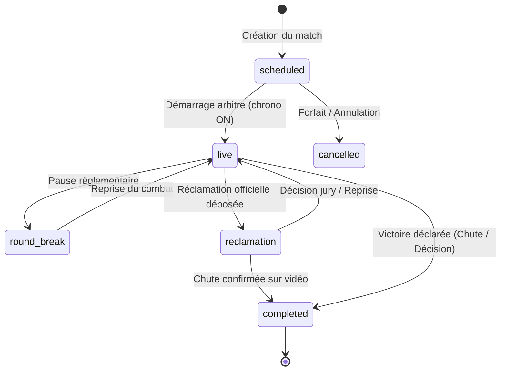
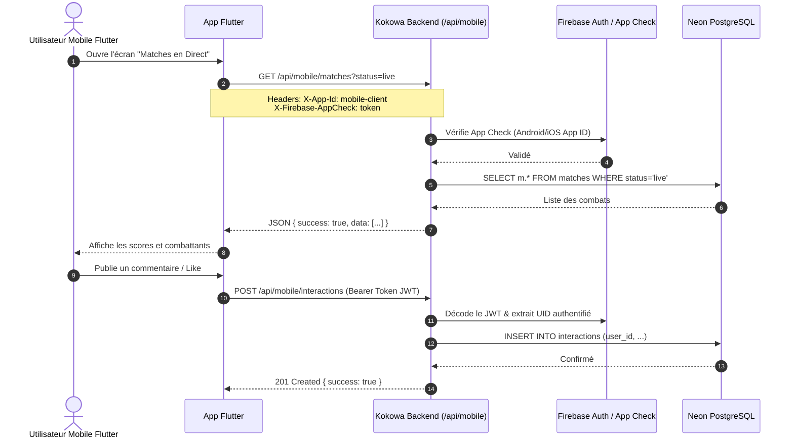

# CAHIER DES CHARGES FONCTIONNEL ET TECHNIQUE
# SYSTÈME GLOBAL KOKOWA TV (WEB & API FLUTTER)

---

## 1. Présentation Générale et Contexte

### 1.1. Contexte du Projet
La lutte traditionnelle nigérienne (**Kokowa**) constitue le sport roi et l'expression culturelle par excellence en République du Niger. Chaque année, le championnat national — le **Sabre National** — rassemble les huit régions du pays dans une arène pendant dix jours de ferveur populaire. 

Historiquement, le suivi des combats, l'arbitrage, le calcul des classements régionaux et la qualification pour les phases finales individuelles reposaient sur des procédures manuelles ou des feuilles de match papier, créant des lenteurs, des risques d'erreurs et limitant l'accès en temps réel pour la diaspora et le grand public.

**Kokowa TV** est la plateforme numérique de référence conçue pour moderniser, sécuriser, archiver et diffuser l'intégralité de ces compétitions. Elle se compose d'une application web Next.js (portail public et back-office de supervision sportive) et d'un ensemble d'API REST hautement optimisées alimentant l'application mobile développée sous Flutter.

### 1.2. Objectifs Stratégiques
1. **Numérisation du Moteur de Tournoi** : Structurer la compétition en phases de poules régionales (10 contre 10) et en phases éliminatoires directes pour le titre individuel de champion national (Sabre National).
2. **Supervision des Combats en Direct** : Fournir une interface de contrôle pour les commissaires de match et la table d'arbitrage (chronomètre de combat, gestion des avertissements/cartons, saisie des chutes et décisions arbitrales).
3. **Synchronisation Temps Réel Multi-Écrans** : Diffuser instantanément les scores, le temps écoulé et le statut du combat en direct vers le web et les mobiles grâce à Firebase Realtime Database.
4. **Alimentation de l'Application Mobile Flutter** : Offrir des points d'accès API rapides, sécurisés, paginés et résilients aux contraintes de réseau mobile (Edge caching, rate limiting, payloads optimisés).
5. **Sauvegarde du Patrimoine Sportif** : Archiver les palmarès, biographies des gladiateurs, historiques des éditions et vidéos des combats.

---

## 2. Rôles et Matrice des Droits d'Accès

Le système applique le principe du moindre privilège avec un contrôle strict côté serveur (*Role-Based Access Control - RBAC*).

| Rôle | Périmètre d'Accès | Droits & Responsabilités Métier |
| :--- | :--- | :--- |
| **Administrateur (`admin`)** | Plateforme complète, `/ad/*`, API protégées | Gestion des compétitions, éditions, configuration système, attribution des rôles, gestion des utilisateurs, purge/sauvegarde de base de données. |
| **Éditeur (`editor`)** | `/ad/articles`, `/ad/media`, `/ad/videos` | Rédaction, publication et mise à jour des articles de presse, reportages vidéos, galeries photos et communications officielles. |
| **Gestionnaire Lutteurs (`fighter_manager`)** | `/ad/fighters`, `/ad/transfers`, `/ad/achievements` | Enregistrement des lutteurs, validation des transferts régionaux, mise à jour des mensurations et attribution des palmarès. |
| **Superviseur de Match / Arbitre (`moderator`)** | `/ad/matches/[matchId]`, `/ad/phase-groups/[groupId]` | Démarrage/pause du chronomètre, saisie des scores, attribution des sanctions (cartons), validation des vainqueurs de combat. |
| **Utilisateur Authentifié (`user`)** | Portail web public, Application Mobile Flutter | Consultation du direct, commentaires sur les articles/matches, likes, favoris/signets, gestion de son profil personnel. |
| **Visiteur Public (Anonyme)** | Portail web public, flux d'actualités mobile | Consultation en lecture seule des classements, fiches lutteurs, calendrier des matches et retransmissions live. |

---

## 3. Périmètre Fonctionnel et Règles Métier

### 3.1. Gestion du Tournoi et Hiérarchie Sportive
Le tournoi suit une arborescence relationnelle rigoureuse :
- **Compétition** (`competitions`) : Entité racine (ex: *Championnat National de Lutte Traditionnelle*).
- **Édition** (`competition_editions`) : Occasion annuelle (ex: *45ème Édition - Agadez 2024*).
- **Phase** (`phases`) :
  - **Phase de Poule** (`phase_type: 'group'`) : Deux poules de 4 régions ou confrontation collective.
  - **Phases d'Élimination Directe** (`phase_type !== 'group'`) : 1/8 de finale, 1/4 de finale, demi-finales, combat pour la 3ème place, et la Grande Finale du Sabre.
- **Groupe de Phase** (`phase_groups`) : Journée ou plateau de combat dans l'arène.
- **Sous-Groupe / Rencontre** (`sub_groups`) :
  - En phase de poule : confrontation officielle opposant deux régions (ex: *Niamey vs Tahoua*), divisée en session du **Matin** ou du **Soir** (`period: 'matin' | 'soir'`).
  - En phase d'élimination : confrontation unitaire rattachée aux régions respectives des deux combattants.
- **Match** (`matches`) : Combat individuel (Lutteur 1 vs Lutteur 2).

### 3.2. Règles Métier de l'Élimination Directe
1. **Invincibilité pour le Sabre National** : Un lutteur terrassé lors d'un combat quelconque voit son indicateur `is_eliminated` basculer à `true` dans `edition_fighters`. Il ne peut en aucun cas être aligné dans un combat pour le Sabre.
2. **Exclusion des Combats Redondants** : Lors de l'organisation d'une phase, le sélecteur exclut automatiquement tout lutteur ayant déjà combattu ou programmé dans cette même phase.
3. **Appariement Automatique et Sous-Groupes Déduits** : Lorsque l'administrateur apparie le Lutteur A (Région X) et le Lutteur B (Région Y), le système crée ou réutilise automatiquement le `sub_group` correspondant à ce couple régional et à la période sélectionnée.

### 3.3. Déroulement et Supervision d'un Match en Direct
- **Chronomètre Règlementaire** : Décompte officiel (2 périodes de combat et pause). Mise en pause immédiate sur coup de sifflet arbitral.
- **Sanctions & Cartons** : Attribution de cartons jaunes et rouges (`fighter_cards`) avec impact sur le temps ou disqualification.
- **Saisie du Résultat** : Désignation du vainqueur (`winner_fighter_id`), du perdant (`loser_fighter_id`), du type de victoire (*chute nette*, *aux points*, *abandon*, *décision médicale*) et de la durée totale réelle (`total_duration`).
- **Diffusion Synchronisée** : Toute mutation met à jour la base PostgreSQL principale et émet simultanément un payload Firebase RTDB sous `editions/{editionId}/subGroups/{subGroupId}/matches/{matchId}`.

---

## 4. Spécifications de l'API Mobile Flutter

L'application mobile Flutter communique avec le backend via les routes préfixées `/api/mobile/*`.

### 4.1. Principes Directeurs des API Mobiles
1. **Pacte de Stabilité des Contrats** : Les clés JSON existantes (`editionId`, `fighterId`, `isChampion`, `profilePicture`, etc.) sont préservées pour éviter tout crash de l'application Flutter en production.
2. **Protection Contre la Falsification d'Identité** : Lors de la soumission de messages ou d'interactions, l'identité de l'utilisateur n'est plus déduite d'un simple champ texte `authId` dans le body, mais **strictement extraite et validée depuis le jeton Bearer Firebase**.
3. **Format des Données Bilingue / Multi-Régions** : Support des noms en Français et Haoussa pour les termes de lutte traditionnels.

---

## 5. Exigences Non Fonctionnelles

### 5.1. Sécurité et Résilience
- **Zéro Clé Statique Hardcodée** : Toutes les clés de service (Firebase Admin, Neon Connection String, Upstash Redis) sont injectées par variables d'environnement serveur.
- **Protection Anti-DDoS et Anti-Scraping** : Rate Limiting configurable par IP et par client d'application (`RateLimiter` avec support Redis en production).
- **Filtrage des Données Sensibles** : Les hachages de mots de passe (`password_hash`) et tokens FCM sont rigoureusement exclus de toute réponse API publique ou utilisateur.
- **En-têtes de Sécurité HTTP** : Activation de `Strict-Transport-Security`, `X-Content-Type-Options: nosniff`, `X-Frame-Options: SAMEORIGIN` et `Referrer-Policy`.

### 5.2. Performance et Base de Données
- **Temps de Réponse Cible** : Moins de 200 ms sur les endpoints mobiles critiques (hors latence réseau radio).
- **Indexation Stratégique** : Index B-Tree sur les clés étrangères et prédicats de filtrage fréquents (`edition_fighters(edition_id, is_eliminated)`, `matches(sub_group_id, status)`).
- **Pool de Connexions** : Pool `pg` avec reconnexion automatique, keep-alive et limite de charge configurée à 10 connexions pour préserver le quota Neon Serverless.

---

## 6. Critères d'Acceptation et Validation

1. **Intégrité de la Compétition** : Il est impossible pour un lutteur éliminé de figurer sur une fiche de combat éliminatoire sans une modification administrative explicite.
2. **Conformité des Types** : Le projet compile sans aucun avertissement ni erreur TypeScript (`bun run typecheck` renvoie le code 0).
3. **Indépendance Mobile** : Toute indisponibilité temporaire du site web public ne doit pas interrompre le service des API mobiles Flutter.
4. **Traçabilité des Actions d'Arbitrage** : Les modifications de score et de statut de match sont enregistrées avec horodatage strict et identifiant du responsable.
