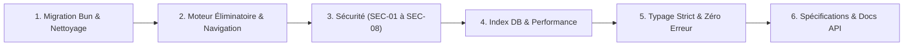

# PLAN D'ACTION, D'OPTIMISATION ET DE MAINTENANCE — KOKOWA TV

> **Document de Référence d'Évolution et de Maintenance**  
> **Statut global** : Phases 1 à 7 Complétées avec succès — Zéro Régression TypeScript

---

## 1. Vue d'Ensemble des Chantiers Réalisés

Le projet Kokowa TV a franchi une étape majeure de refonte technique, de durcissement sécuritaire et de formalisation documentaire.

---

## 2. Synthèse des Réalisations par Axe

### Axe 1 : Moteur de Tournoi & Interface Administrateur
- **Page autonome `/ad/matches/[matchId]`** :
  - Découplage de la route par rapport à `subGroupId`.
  - Résolution dynamique de toutes les métadonnées (lutteurs, région, arbitres, édition).
  - Synchronisation du carrousel avec l'ensemble des matchs du `phase-group` lors des phases à élimination directe.
- **Matchmaking des Phases Éliminatoires (`/ad/phase-groups/[groupId]/organisation`)** :
  - Filtrage strict des lutteurs déjà éliminés (`is_eliminated === false`).
  - Exclusion des lutteurs ayant déjà combattu dans le groupe courant.
  - Sélecteur multi-critères avec recherche textuelle et filtrage régional sans anomalie d'affichage.
  - Choix du créneau horaire (`morning` / `evening`) et génération automatique du sous-groupe sous-jacent.
  - Mode création multiple par paires (`bulk creator`).

### Axe 2 : Durcissement Sécuritaire (Audit & Correctifs)
- Protection `assertAdmin()` sur les Server Actions d'administration (`actions/database.ts`, `actions/users.ts`).
- Protection contre les injections SQL par liste blanche de colonnes (`importTableData`).
- Purge systématique des empreintes `password_hash` (`sanitizeUser`).
- Validation cryptographique des jetons Firebase JWT sur l'API mobile (`POST /api/mobile/messages` et `interactions`) pour neutraliser les failles IDOR/BOLA.
- Protection RBAC du layout `/ad` et protection de l'endpoint `/api/database` via `withAdminAuth`.
- En-têtes HTTP défensifs stricts configurés dans `next.config.ts`.

### Axe 3 : Performance & Base de Données
- Migration `007-performance-indexes.sql` introduisant les index composites cruciaux (`edition_fighters`, `matches`, `sub_groups`, `users`, `interactions`, `messages`).
- Nettoyage du `package.json` (suppression de `@prisma/client`, `mysql2`, normalisation des scripts sur `bun`).

### Axe 4 : Qualité Logicielle & Typage Strict
- Harmonisation du type `ViewMode` dans `@/types/index.ts`.
- Correction du hook `useEntityList` (prise en compte de `apiPath`, sérialisation des filtres, invalidation du cache).
- Validation complète : **`bun run typecheck` renvoie 0 erreur**.

### Axe 5 : Documentation de Référence
- Rédaction du Cahier des Charges complet (`CAHIER.md`).
- Rédaction du Rapport d'Audit & Analyse (`ANALYSIS.md`).
- Guide complet des Server Actions (`actions/README.md`).
- Documentation de l'API Web & Middleware (`app/api/README.md`).
- Contrat d'interface REST pour l'application Flutter (`app/api/mobile/README.md`).
- Mise à jour du guide principal (`README.md`).

---

## 3. Feuille de Route Future & Maintenance Recommandée

### Court Terme (Prochaine release mineure)
1. **Application de la migration d'index en production** :
   - Exécuter `bun run db:migrate` sur l'instance Neon de production avant l'ouverture du prochain tournoi.
2. **Revue des règles de sécurité Firebase** :
   - Aligner les règles Firebase RTDB sur les rôles définis dans les custom claims Firebase Auth.

### Moyen Terme (Évolution v2.1)
1. **Tests End-to-End Automatisés (Playwright)** :
   - Couvrir les scénarios de bout en bout : connexion admin -> création d'un match éliminatoire -> saisie du score -> validation de la mise à jour de `is_eliminated`.
2. **Mise en cache Redis pour les endpoints mobiles publics** :
   - Brancher Upstash Redis sur les routes `GET /api/mobile/editions` et `GET /api/mobile/fighters` avec un TTL de 60 secondes pour réduire la charge sur Neon.

### Long Terme (Architecture v3.0)
1. **Génération automatisée des tableaux de tournoi (Bracket Tree)** :
   - Module d'auto-remplissage des quarts, demi-finales et finale à mesure des victoires enregistrées.
2. **Diffusion Vidéo Intégrée (WebRTC / HLS)** :
   - Intégration d'un lecteur vidéo optimisé pour les spectateurs avec synchronisation du chat en direct.
