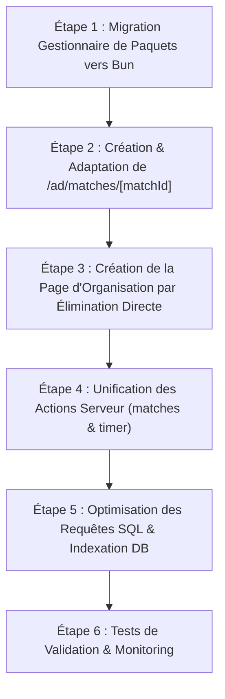

# PLAN D'OPTIMISATION ET DE REFONTE - KOKOWA TV

## 1. Diagnostic des Insuffisances Actuelles & Impacts sur la Performance

### A. Performance Base de Données & Requêtes SQL (`actions/`, `lib/db/`)
1. **Requêtes Monolithiques avec Subqueries JSON_AGG Imbriquées à l'Excès** :
   - *Constat* : Dans `actions/editions.ts` (`getEditionByIdWithRelations`), la requête SQL agrège sur 4 niveaux imbriqués (`editions` -> `phases` -> `phase_groups` -> `sub_groups` -> `matches` -> `fighters`).
   - *Impact* : Temps d'exécution dépassant 1.5 à 3 secondes sur Neon PostgreSQL, verrouillage de mémoire important, sérialisation JSON lourde.
   - *Solution* : Découper les requêtes en requêtes parallèles ciblées ou utiliser des DataLoader / jointures plates paginées avec mise en cache TanStack Query / Next.js.
2. **Index Manquants sur Clés Étrangères et Filtres Fréquents** :
   - *Constat* : Les colonnes `edition_fighters(is_eliminated, edition_id, region_id)`, `matches(sub_group_id, status, match_date)`, et `sub_groups(group_id)` subissent des scans séquentiels (Seq Scan) lors des filtres fréquents.
   - *Impact* : Dégradation progressive des performances à mesure que l'historique des matches s'accumule.
   - *Solution* : Créer les index composites appropriés (`idx_edition_fighters_active_eliminated`, `idx_matches_subgroup_status`).
3. **Absence de Transactions Strictes sur les Mises à Jour Critiques** :
   - *Constat* : Dans certaines actions (ex: mise à jour du match et élimination du combattant), plusieurs requêtes `query()` sont exécutées séparément au lieu d'utiliser un client unique avec `BEGIN ... COMMIT`.
   - *Impact* : Risque d'incohérence de données en cas d'erreur réseau intermédiaire.
   - *Solution* : Encapsuler systématiquement les mutations d'état dans une transaction PostgreSQL via un PoolClient dédié.

### B. Architecture du Code & Redondances (`actions/`, `hooks/`)
1. **Dédoublement des Actions Serveur (`actions/matches.ts` vs `actions/matches-2.ts`)** :
   - *Constat* : Deux fichiers distincts implémentent des fonctions similaires avec des divergences de typage et de logique (ex: `updateMatch`, `getMatchById`).
   - *Impact* : Risque de régression, confusion lors de l'import, bugs silencieux où un composant utilise une version obsolète.
   - *Solution* : Fusionner `matches-2.ts` dans `matches.ts` en conservant l'implémentation la plus robuste (PostgreSQL JSONB + `updateMatchAndRecompute`).
2. **Duplication des Hooks de Gestion (`use-entities.ts` vs `use-entity-list.ts`, `use-match-timer.ts` vs `use-match-timer-2.ts`)** :
   - *Constat* : Deux systèmes parallèles gèrent le fetching d'entités avec pagination et filtrage.
   - *Impact* : Comportements asynchrones incohérents, code mort, bundle client inutilement alourdi.
   - *Solution* : Unifier sous un hook canonique `useEntityList` optimisé avec TanStack Query.
3. **Dépendances Redondantes dans `package.json`** :
   - *Constat* : Présence simultanée de `framer-motion` et `motion`, ainsi que de `ioredis`, `redis` et `@upstash/redis`, plus les faux packages `child_process` et `dgram`.
   - *Impact* : Poids accru du `node_modules`, temps d'installation allongé, risques de conflits de versions.
   - *Solution* : Nettoyer `package.json`, standardiser sur `bun` et éliminer les dépendances superflues.

### C. Gestion du Temps Réel & WebSocket (`lib/realtime/`, `hooks/realtime/`)
1. **Multiplication des Canaux de Synchronisation** :
   - *Constat* : L'application mélange Firebase Realtime Database (RTDB), Firestore, des appels WebSockets et du polling HTTP.
   - *Impact* : Surcharge réseau côté client, désynchronisation possible des chronomètres entre arbitres et spectateurs.
   - *Solution* : Définir Firebase RTDB comme source de vérité unique pour l'état en direct (`isLive`, `elapsed`, `status`, `winner`), et PostgreSQL comme source de vérité pour la persistance historique.

---

## 2. Plan d'Implémentation et Roadmap d'Optimisation

### Phase 1 : Migration vers Bun & Nettoyage des Dépendances
- Mettre à jour `package.json` :
  - Remplacer les scripts appelant `npm` / `pnpm` par `bun run`.
  - Supprimer les faux packages intégrés (`child_process`, `dgram`).
  - Ajouter le champ `"packageManager": "bun@1.4.3"`.
- Mettre à jour `railway.json` pour déployer via Bun (`bun run build && bun run start`).
- Valider la compatibilité d'exécution avec `bun`.

### Phase 2 : Implémentation de la Page Détail Match Autonome
- Copier et adapter `app/(admins)/ad/sub-groups/[subGroupId]/matches/[matchId]` vers `app/(admins)/ad/matches/[matchId]` :
  - `page.tsx` : extraire uniquement `matchId` des `useParams()`.
  - Charger les données du match via `getMatchById`.
  - Résoudre automatiquement le sous-groupe, les lutteurs disponibles et l'édition.
  - Adapter la navigation précédente/suivante et le retour vers `/ad/matches`.
  - Transférer les sous-composants (`fighter-control.tsx`, `match-controls.tsx`, `match-timer.tsx`, `media-manager.tsx`, `floating-match-score.tsx`).

### Phase 3 : Organisation des Combats pour les Phases d'Élimination
- Dans `app/(admins)/ad/phase-groups/[groupId]/page.tsx` :
  - Ajouter un bouton/lien mis en avant vers la nouvelle page d'organisation dès que `group.phase?.phase_type !== 'group'`.
- Créer la nouvelle page `app/(admins)/ad/phase-groups/[groupId]/organisation/page.tsx` :
  - Récupérer les lutteurs de l'édition avec `is_eliminated = false`.
  - Filtrer et exclure les lutteurs ayant déjà un combat (en cours, programmé ou achevé) dans le groupe courant.
  - Intégrer un sélecteur intuitif avec barre de recherche (nom, prénom, surnom) et filtre par région.
  - Développer l'action de création automatique de match :
    - Vérification / création automatique du `sub_group` adapté (avec `region1_id` et `region2_id` des deux lutteurs).
    - Création du match avec statut `scheduled`.
    - Invalidation des caches TanStack Query pour affichage immédiat.

### Phase 4 : Consolidation & Optimisation Backend
- Fusionner `actions/matches-2.ts` dans `actions/matches.ts`.
- Ajouter un filtre `is_eliminated` direct dans `getEditionFighters` (`actions/editions.ts`).
- Appliquer un script de migration SQL pour ajouter les index manquants sur `edition_fighters` et `matches`.
